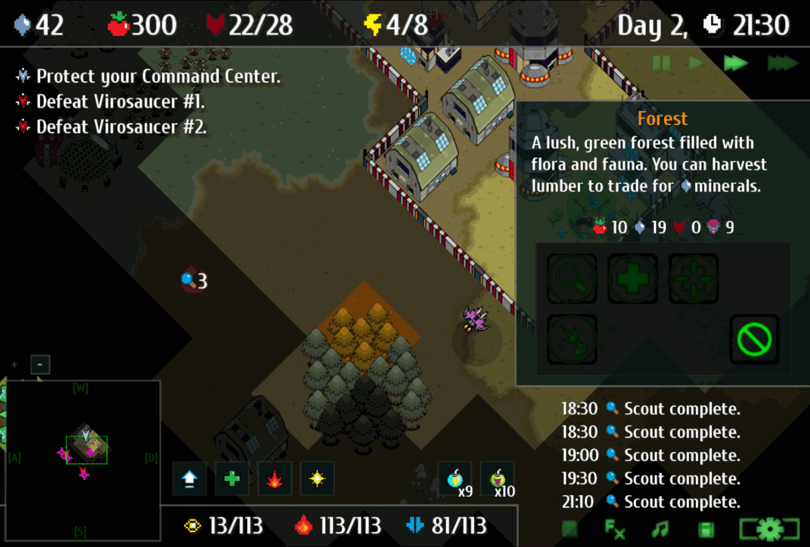

# Peacefree: Tactical Warfare - Revival

An unofficial fan patch of [Peacefree: Tactical Warfare](https://www.kongregate.com/en/games/helgravis/peacefree-tactical-warfare), the tactical strategy Flash game by Adventure Cat, LLC, released on Kongregate by Helgravis in 2014. Flash is gone, and so is Kongregate's purchase service, so the game's premium features could no longer be bought. This release unlocks them, runs without any network connection, and adds quality-of-life changes. The gameplay is unchanged.

It isn't made or endorsed by Adventure Cat, LLC, Helgravis or Kongregate. If the developer asks, it comes down.



## Download and play
Get the files from the [latest release](https://github.com/hamsterkoster/PeacefreeRevival/releases/latest) and pick one way to play:

1. **The Windows app** (64-bit Windows; tested on Windows 11). The easiest: it brings its own player, so there's nothing else to install.
   - `Peacefree-Revival-1.0-Windows-Setup.exe` installs it for your user only, with no admin prompt, a Start menu entry and a desktop shortcut. Uninstall it in Windows' Settings > Apps > Installed apps; your saves stay.
   - Or `Peacefree-Revival-1.0-Windows.zip`: unzip it and open `Peacefree Revival.exe` in the `Peacefree Revival` folder.
   - The first time, Windows says "Windows protected your PC", because the app isn't code-signed: click More info, then Run anyway. A splash screen shows for about 2 seconds before the game (the free AIR SDK's).
2. **`Peacefree-Revival-1.0.swf` in the Flash Player projector** (Windows). It runs as smoothly as the Windows app (about 60 fps on our test PC). Adobe no longer lists it on its site, but its old download link still works: [flashplayer_32_sa.exe](https://fpdownload.macromedia.com/pub/flashplayer/updaters/32/flashplayer_32_sa.exe) (version 32.0.0.465, signed by Adobe Inc.), or the [Wayback Machine's copy](https://web.archive.org/web/2021id_/https://fpdownload.macromedia.com/pub/flashplayer/updaters/32/flashplayer_32_sa.exe) if Adobe's is gone.
   - Check it before running it. In PowerShell, this must print `A4B333AC1DA12026989549015303D82231982838BCCFB544BA5FD188746066F0`:

     ```powershell
     (Get-FileHash "$env:USERPROFILE\Downloads\flashplayer_32_sa.exe").Hash
     ```

   - Open it, then File > Open and pick the .swf, or drag the .swf onto `flashplayer_32_sa.exe`.
3. **`Peacefree-Revival-1.0.swf` in [Ruffle](https://ruffle.rs/downloads)'s desktop app** (Windows, macOS, Linux), a Flash Player emulator: open the .swf with it (tested with its nightly build of 2026-10-29). It's slower (about 40 fps on our test PC) and draws some things wrong.

There's no browser version: Ruffle in a browser runs this game at about 15 fps. A separate, from-scratch HTML5 rewrite that would run in a browser and be moddable is planned as its own open-source project, **PeacefreeWeb** — an independent hobby effort, not maintained here, and it may or may not get finished.

## What's new
Compared with the original (version 1.08 on Kongregate). All changes: [CHANGELOG.md](CHANGELOG.md).
- Premium unlocked, and free Shock and Nox bombs: 10 of each every time you start the game (the count isn't saved), and 10 more from the shop whenever you like.
- A Settings button on the title and campaign screens: music and sound volume, the speed new acts start at, Fullscreen, and a Controls page listing every key.
- Muting the music pauses the song; in a mission, the options panel's Next button skips to the next song.
- The window can be resized or made fullscreen; the game keeps its shape with black bars.
- "Unlock All Acts" in the options opens every act at once. It can't be undone.
- No network connections, and no Kongregate account needed.

## Good to know
- **Saves:** each way to play keeps its own. The Windows app saves in `%APPDATA%\io.github.hamsterkoster.PeacefreeRevival\Local Store\`; the projector in Flash Player's own folder, `%APPDATA%\Macromedia\Flash Player\#SharedObjects\`, where every version of this .swf shares one save. Progress from playing on Kongregate can't be carried over; "Unlock All Acts" skips straight to any act.
- **The frame rate:** the P key shows or hides it.

## Why I made this
This was one of my favorite Flash games when it came out, and it's an underrated gem. It's very reminiscent of the Rebuild games, with an interesting mix of real-time and turn-based play. It's simple enough to pick up easily, yet expanding your base makes for a satisfying gameplay loop. If you've played They Are Billions, it's similar in the way you grow your base as you explore the map for resources.

I actually held the top score for most enemies defeated and most recuse in one game on the  Kongregate leaderboard for a very long time  (My kongregate account was peter90745). There's also a prequel, [Peacefree: ILA](https://www.newgrounds.com/portal/view/612878), which is rougher around the edges but has a full storyline, bad (charming?) voice acting, and soldiers you can equip one by one during battle. It seemed like the developer had bigger plans for the series, but they never came to be, and the games sat abandoned. After Flash died, this game was no longer fully playable. So I decided to unlock all the premium content and add a few quality-of-life changes, while keeping the original gameplay the same.

## Privacy
Peacefree Revival collects no data and makes no network connections: the game's link to Kongregate is replaced by an offline stand-in, and your saves stay on your PC. The only links are the Facebook and Twitter buttons that appear on the Tech screen after you click "Want Free Medals?"; they open the developer's pages in your browser when you click them. As for the Windows app's AIR runtime, Wipro's [AIR SDK License Agreement](https://airsdk.wxlift.com/assets/pdfs/Wipro%20AIR%20SDK%20License%20Agreement.pdf) (section 6.4) says it doesn't send your information back to Wipro.

## Credits
The game:
- **Peacefree: Tactical Warfare**, (c) 2014 Adventure Cat, LLC: program and art by Daniel John Pua, published on Kongregate by Helgravis. All rights to the game remain with them, except the parts by others below. The Windows app's icon is the game's own title-screen chevron.
- Parts by others, in the original .swf (their license texts: [THIRD-PARTY-NOTICES.txt](THIRD-PARTY-NOTICES.txt), also in the Windows app's folder):
  - **[Starling Framework](https://github.com/Gamua/Starling-Framework)** 1.4.1 by Gamua, Simplified BSD License: the game's GPU rendering library, with its [particle system extension](https://github.com/Gamua/Starling-Extension-Particle-System) and Adobe's AGALMiniAssembler (BSD license).
  - **[Cuprum](https://fonts.google.com/specimen/Cuprum)**, the game's font, by Jovanny Lemonad, SIL Open Font License 1.1.
  - **The music** by Jason Shaw, [Audionautix](https://audionautix.com), Creative Commons Attribution 4.0.

In the Windows app's downloads:
- **[AIR SDK](https://airsdk.wxlift.com/download)** 51.5.1 by Wipro Connected Services (formerly HARMAN), with the Adobe AIR runtime: the app's runtime, packaged with the game. Proprietary ([AIR SDK License Agreement](https://airsdk.wxlift.com/assets/pdfs/Wipro%20AIR%20SDK%20License%20Agreement.pdf), free tier).
- **[Inno Setup](https://jrsoftware.org/isinfo.php)** 6.7.3 by Jordan Russell and Martijn Laan, the Inno Setup License (free, also for commercial use): builds the installer.

Players linked above, not included: **Adobe Flash Player projector** 32 by Adobe (proprietary) and **[Ruffle](https://ruffle.rs)** by Ruffle LLC and contributors (MIT or Apache-2.0).

Tools that build and check the patch, not included:
- **[JPEXS Free Flash Decompiler (ffdec)](https://github.com/jindrapetrik/jpexs-decompiler)** 26.4.0 by Jindra Petřík and contributors, GPL-3.0: decompiles and rebuilds the .swf.
- **[Ruffle](https://ruffle.rs)**'s web version: the Flash emulator behind the headless check.
- **[Playwright](https://github.com/microsoft/playwright-python)** 1.64.1 by Microsoft, Apache-2.0, with Chrome Headless Shell by the Chromium Authors (BSD-style license): runs the headless check.
- **[Pillow](https://python-pillow.org)** 13.0.0 by Jeffrey A. Clark and contributors, MIT-CMU: the checks' pixel tests and the installer's icon.
- **[Ruff](https://docs.astral.sh/ruff)** 0.17.3 by Astral, MIT: lints our scripts.

## License
Our own work in this repo (everything except the game's code, icons and screenshots, and THIRD-PARTY-NOTICES.txt) is under the MIT License: [LICENSE](LICENSE). The game itself isn't: its code in `decompiled/` and `src/`, its art, sound and music, and the game in the downloads stay Adventure Cat, LLC's, except the parts by others, which are under their own licenses ([THIRD-PARTY-NOTICES.txt](THIRD-PARTY-NOTICES.txt)).

## For developers
How the patches are made, and how to set up, build, check and release: [docs/building.md](docs/building.md). The log of every patch, build and test: [NOTES.md](NOTES.md). Findings by topic: [docs/research/](docs/research/). Decisions and their reasons: [docs/decisions.md](docs/decisions.md). The to-do list: [docs/todo.md](docs/todo.md).
